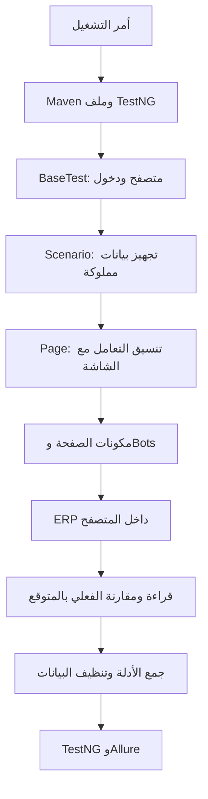
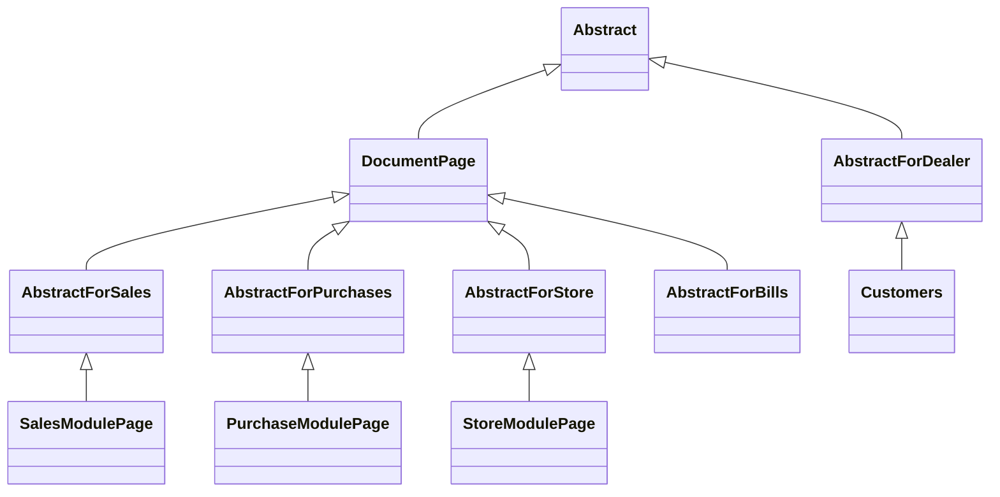

# 3 — خريطة المشروع والبنية

[السابق](02_READING_JAVA_AR.md) · [الرئيسية](README_AR.md) · [التالي](04_TEST_JOURNEY_AR.md)

## 3.1 المشروع كفريق عمل

اعتبر الاختبار مدير مهمة يقول «أنشئ فاتورة ثم تحقق منها». صفحة الشاشة هي الموظف اللي يعرف مكان الأزرار. المكونات فرق متخصصة للبنود والفلاتر والحسابات. Bots وFormInteractions أدوات التنفيذ. Fixtures مسؤول المخزن اللي يجهز مستلزمات التجربة ويستردها. التقرير دفتر الأدلة.

الخلط بينهم كان يخلي تغيير اختيار صنف يلمس الطباعة أو التنظيف. الفصل الحالي هدفه إن لكل تغيير مكانًا مفهومًا.

## 3.2 مسار الطلب

السهم هنا يشرح المسار المعتاد، مش معناه كل ملف بينادي اللي بعده مباشرة في كل حالة. بعض الفحوص المحلية لا تدخل مسار المتصفح أصلًا.

## 3.3 الفولدرات الأساسية

| المكان | وظيفته | مثال |
|---|---|---|
| `src/main/java` | كود الإطار القابل لإعادة الاستخدام: الصفحات والأدوات والحسابات والإعدادات | SalesModulePage |
| `src/test/java` | حالات الاختبار وتجهيز بياناتها ومحاكاتها والتحقق المحلي | SalesInvoiceCoverageTest |
| `src/main/resources` | إعدادات يقرأها الإطار | WebData.properties |
| `src/test/resources` | تعريفات TestNG وبيانات اختبار وملفات شرح قريبة منها | smoke-testng.xml |
| `config` | إعدادات محلية أو قالب إعداد خدمة التقارير | Login.local.properties إذا موجود |
| `scripts` | أوامر مساعدة للتشغيل وفحص الأسرار وإرسال التقارير | Test-Project.ps1 |
| `.github/workflows` | تعريف التشغيل المستضاف | local-checks.yml |
| `docs` | توثيق المشروع | الدليل الحالي |
| `outputs` | ملفات تسليم مولدة مثل مستندات وشيتات؛ ليست جزءًا من تجميع Java | ملفات العمل السابقة |
| `target` | نواتج البناء والاختبارات وسجلات الاسترجاع | surefire-reports وfixture journals |
| `allure-results` | نتائج خام للتقرير | JSON ومرفقات |
| `allure-report` | صفحات التقرير المولدة | HTML |
| `screenshots` و`videos` | أدلة أو نواتج بحسب الاستخدام والإعداد | صورة فشل |

وجود فولدر `main` لا يعني كود المنتج التجاري. هو هنا كود إطار الاختبارات. ووجود `test` لا يعني تجارب عشوائية؛ ده مكان اختبارات المشروع المقصودة.

## 3.4 الطبقات داخل main

**Drivers:** مين ينشئ المتصفح؟ `WebDriverFactory` يختار المصنع المناسب، و`Chrome` أو `Edge` أو `Firfox` يحدد خيارات المتصفح. الاسم `Firfox` مكتوب كده بالفعل في الكود.

**System_Modules/Login:** الاسم التاريخي طويل، لكنه يحتوي معظم صفحات النظام، مش صفحة الدخول فقط. بداخله مجالات المبيعات والمشتريات والمخازن وغيرها، وقواعد مشتركة.

**Bots:** أدوات منخفضة المستوى للضغط والكتابة والاختيارات والجداول والانتظار. هناك أيضًا `Utiel/FormInteractions` كطبقة تفاعل تستخدمها صفحات أحدث؛ حاليًا الاتنين موجودين، فلا تفترض إن كل التفاعل بيمر من Bots وحده.

**Business/Calculator وModels:** تمثيل الأرقام وسياسة حساب الفاتورة؛ معزول عن معرفة مكان زر حفظ.

**Utiel:** إعدادات وملفات وصور وأدوات تفاعل وتواريخ. `Utiel/Allur` متخصص في التقارير والأدلة وإرسالها. الأسماء القديمة فيها أخطاء إملائية؛ اكتبها كما هي عند البحث.

**Valditon:** تحقق قديم مشترك. بعضه فعال وبعضه معلق؛ أطلس الملفات يوضح الفرق.

## 3.5 البنية الحالية للصفحات

دي خريطة مختصرة لعلاقات مهمة، مش رسم لكل الكلاسات. المبيعات لا ترث من المشتريات، والمخازن لا ترث من المتعاملين. الصفحات تشترك في قدرات المستند من خلال `DocumentPage`. أسماء `AbstractForStore` و`AbstractForPurchases` و`AbstractForBills` أصبحت واجهات توافق رفيعة.

`Abstract` يحتفظ بالواجهة العامة ويفوض التنفيذ لمكونات مثل `PageNavigation` و`PageFormFields`. `PageContext` يجمع اعتمادات الجلسة. `DocumentPage` ينسق البنود والخصم والقراءة والتحقق والطباعة من خلال مكونات محددة.

## 3.6 تنظيم test

هتلاقي فولدرات مثل `Invoice` و`Purches` و`StoreTest` و`ProductsTest`. بداخل المجال غالبًا أكثر من نوع ملف:

- كلاس حالات فعلية: اختبارات محددة عليها `@Test`.
- Scenario: دورة حياة وتجهيز متكرر للمجال.
- Actions أو Workflow: خطوات مشتركة للسيناريوهات.
- TestData: مالك بيانات التجربة وسجلاتها وتنظيفها.
- FixtureDefinitions: وصف البيانات اللي لازم تتعمل.
- FixtureApi: نقل الطلب للبرنامج من الجلسة المصرح بها.
- ApiStub: بديل محلي لاختبار منطقنا بدون ERP.
- Recovery: استئناف التعامل مع بيانات تشغيل توقف.
- CleanupTest: اختبار أن التنظيف نفسه صحيح ولا يحذف بيانات غريبة.

مش كل ملف اسمه TestData مصدر Excel. كثير من بياناتنا تتولد وتتحفظ عبر API داخل جلسة الاختبار.

## 3.7 لماذا الملفات كثيرة بعد التقسيم؟

لأن ملفًا واحدًا كان يعرف أشياء كثيرة. تقسيمه يزيد عدد الملفات لكنه يقلل عدد الأسباب اللي تخلينا نغيّر نفس الملف. مثلًا `InvoiceListCalendar` يعرف التقويم، و`InvoiceListPagination` يعرف الصفحات، و`InvoiceListExport` يعرف اختيار التصدير. `InvoicListPage` يربطهم بواجهة واحدة للاختبار.

عدد الملفات وحده مش مقياس جودة. لو اتقسم كل سطر لملف غير مفهوم يبقى تنظيم سيئ. المعيار: هل تقدر تقول مسؤولية المكون في جملة واضحة؟ وهل التغيير له مكان واحد منطقي؟
